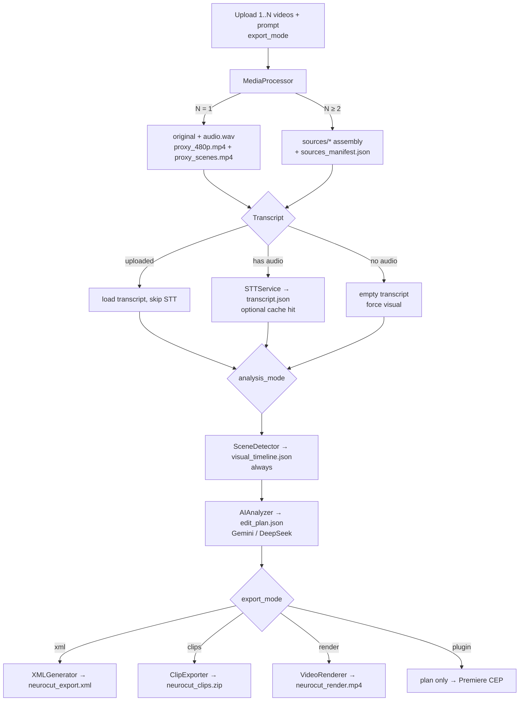
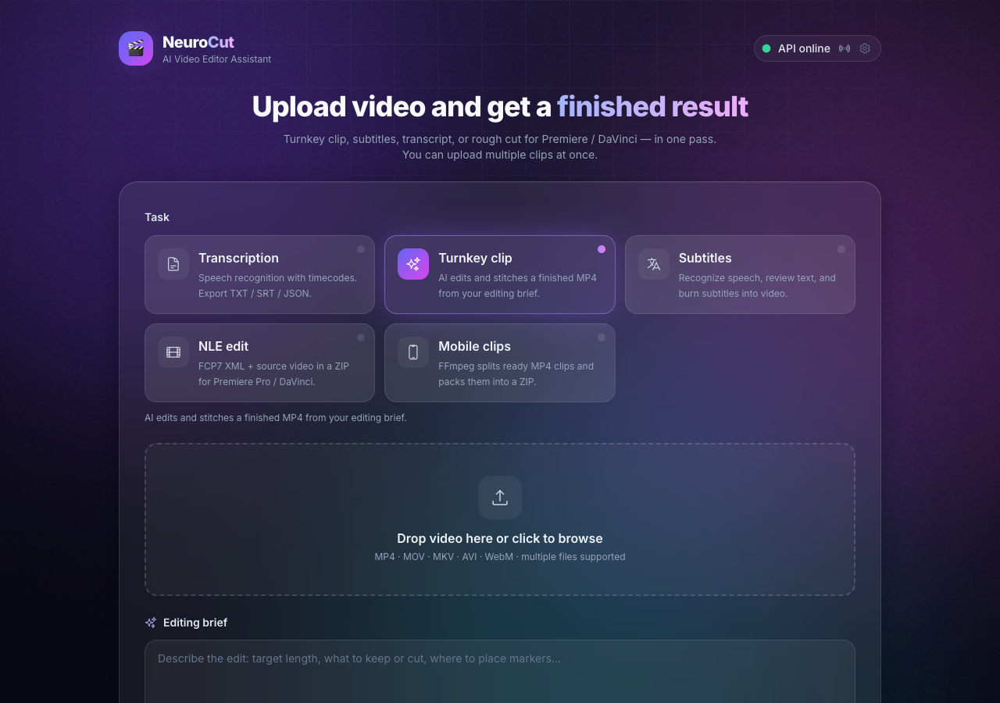
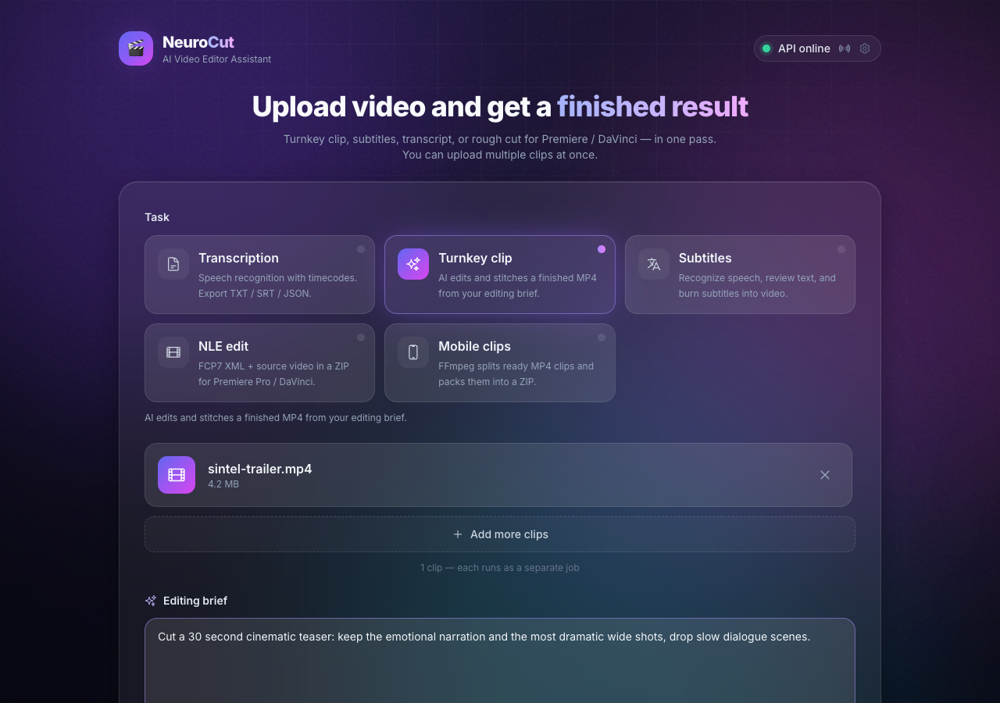
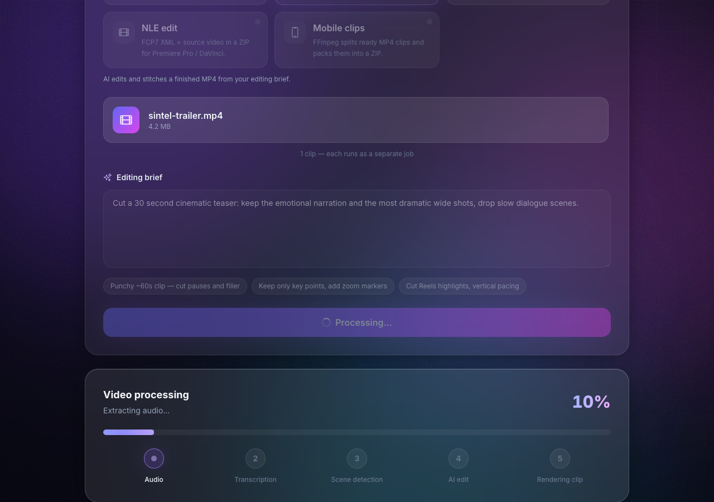
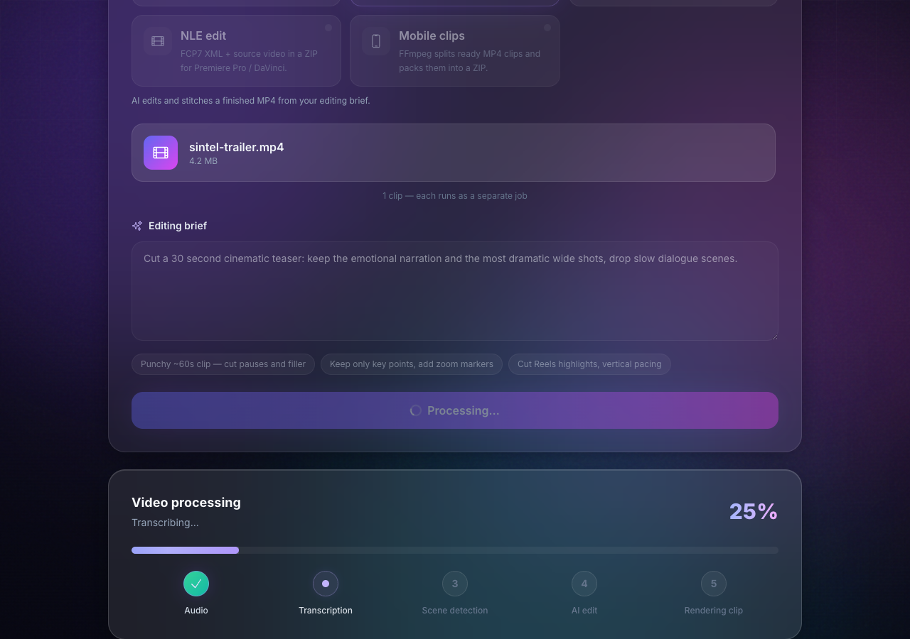
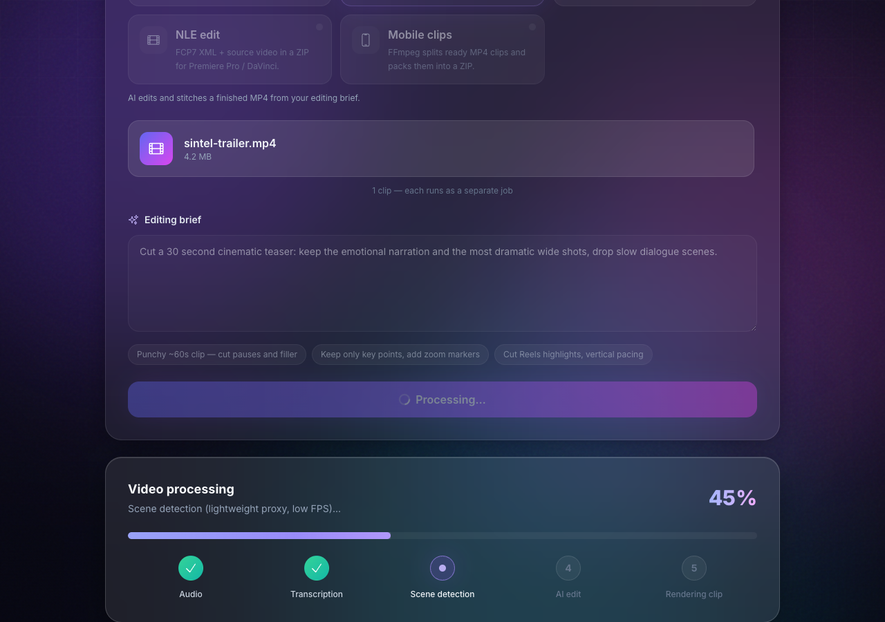
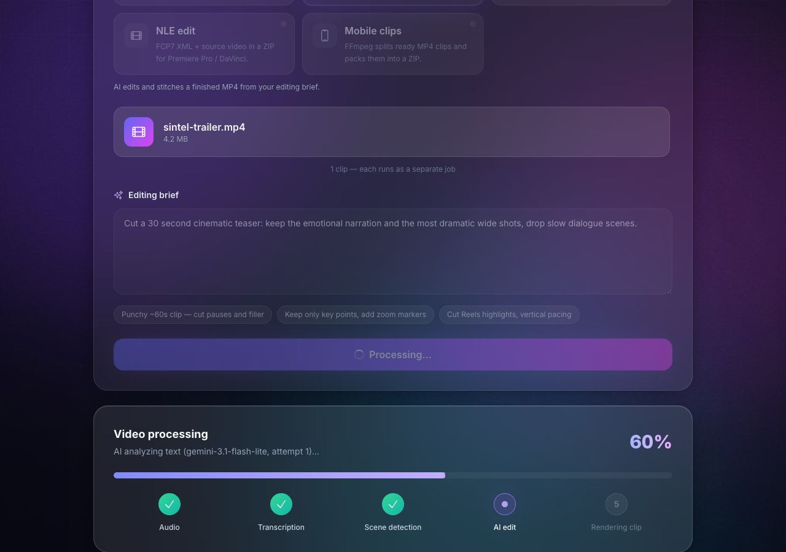
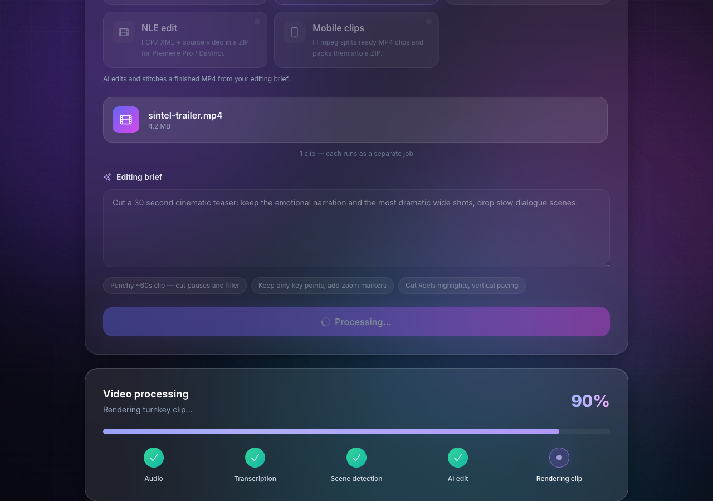
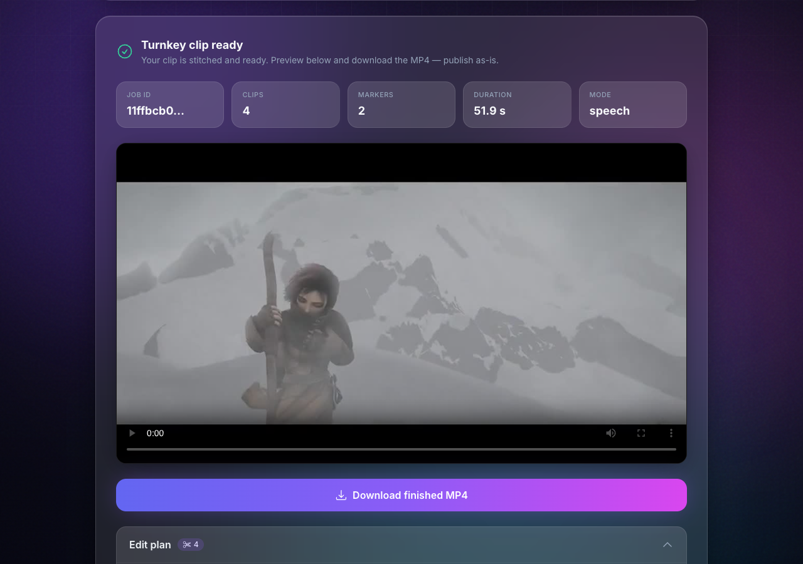

# NeuroCut

[](LICENSE)
[](https://github.com/jdmarshall95/neurocut/actions/workflows/ci.yml)
[](https://www.python.org/)
[](docker-compose.yml)

<p align="center">
  <a href="docs/assets/neurocut-demo.mp4">
    
  </a>
</p>

**AI video editing assistant** — drop in a clip and a text brief, get an automatic rough cut as **FCP7 XML** (Premiere / DaVinci), a **ZIP of MP4 clips**, or a stitched **turnkey MP4**.

Built with FastAPI, React, FFmpeg, Whisper-class STT, scene detection, and Google Gemini.

---

## Features

- **Text-brief montage** — natural-language brief → LLM edit plan (clips + markers)
- **Multi-engine STT** — Whisper / Silero / GigaAM with timestamps and audio-hash cache
- **Scene detection on every job** — low-res / low-FPS proxy; then `speech` or `visual` analysis mode
- **One export mode per job** — FCP7 XML, clips ZIP, or turnkey render (mutually exclusive)
- **Burned-in subtitles** — separate post-job API, not part of the main pipeline
- **Premiere CEP plugin** — apply the plan from a local media path (`export_mode=plugin`)
- **Multi-file sources** — assemble several clips into one editorial timeline
- **Docker-first** — CPU by default; optional GPU override for CUDA Whisper

## Pipeline

Orchestrator: `PipelineRunner` in [`app/services/pipeline.py`](app/services/pipeline.py). Stages run **sequentially**.



`SubtitleBurner` is a separate endpoint (`POST /jobs/{id}/subtitles/render`), not a pipeline stage.

More detail: [docs/architecture.md](docs/architecture.md).

### Walkthrough

End-to-end run on the [Sintel trailer](https://media.w3.org/2010/05/sintel/trailer.mp4)
(52 s) with `export_mode = render` and brief:

> *"Cut a 30 second cinematic teaser: keep the emotional narration and the most dramatic wide shots, drop slow dialogue scenes."*

Finished in **~35 s** → `neurocut_render.mp4`, **4 clips**, **2 markers**, `analysis_mode = speech`.

| # | Stage | What happens | Cold-run time |
|---|-------|--------------|---------------|
| 1 | `extracting_audio` | FFmpeg: audio + 480p proxy + scene proxy | ~15 s |
| 2 | `transcribing` | Whisper-class STT (content-addressable cache) | ~5 s |
| 3 | `analyzing_scenes` | Low-FPS scene detection | ~0.2 s |
| 4 | `ai_editing` | Gemini → edit plan | ~2 s |
| 5 | `rendering_clip` | Stitch turnkey MP4 | ~13 s |

<details>
<summary><b>Stage-by-stage screenshots</b></summary>

<table>
  <tr>
    <td width="50%"></td>
    <td width="50%"></td>
  </tr>
  <tr>
    <td><b>1 · Audio</b><br></td>
    <td><b>2 · Transcription</b><br></td>
  </tr>
  <tr>
    <td><b>3 · Scene detection</b><br></td>
    <td><b>4 · AI edit</b><br></td>
  </tr>
  <tr>
    <td><b>5 · Rendering clip</b><br></td>
    <td><b>Result</b><br></td>
  </tr>
</table>

</details>

## Quick Start

### Requirements

- [Docker](https://docs.docker.com/get-docker/) (Compose v2)
- [Google Gemini API key](https://aistudio.google.com/apikey) (or DeepSeek for text-only tests)

### CPU (default)

```bash
git clone https://github.com/jdmarshall95/neurocut.git
cd neurocut
cp .env.example .env
# set GEMINI_API_KEY=...

docker compose up --build
```

| Service | URL |
|---------|-----|
| **UI** | http://localhost:8501 |
| **API** | http://localhost:8000 |
| **Swagger** | http://localhost:8000/docs |

### GPU (NVIDIA)

Requires [NVIDIA Container Toolkit](https://docs.nvidia.com/datacenter/cloud-native/container-toolkit/latest/install-guide.html).

```bash
docker compose -f docker-compose.yml -f docker-compose.gpu.yml up --build
```

Sets `WHISPER_DEVICE=cuda` and `WHISPER_COMPUTE_TYPE=float16`.

### First edit

1. Open http://localhost:8501
2. Choose a task (turnkey clip, NLE XML, mobile clips, …)
3. Upload video + brief → download the export for that mode

Stop: `docker compose down` · wipe storage: `docker compose down -v`  
Local setup: [CONTRIBUTING.md](CONTRIBUTING.md).

## Usage notes

**Premiere plugin:** `./scripts/install_premiere_plugin.sh` → Window → Extensions → NeuroCut.  
See [docs/plugin-development.md](docs/plugin-development.md).

| Variable | Purpose | Default |
|----------|---------|---------|
| `GEMINI_API_KEY` | Gemini access | required for Gemini |
| `LLM_PROVIDER` | `auto` / `gemini` / `deepseek` | `auto` |
| `STT_ENGINE` | `whisper` / `silero` / `gigaam` / `auto` | `whisper` |
| `WHISPER_MODEL` | Whisper size | `base` |
| `USE_VIDEO_FOR_LLM` | Upload proxy to Gemini | `false` |
| `SCENE_PROXY_FPS` | Scene-detect FPS | `12` |

Full list: [`.env.example`](.env.example) · [`app/core/config.py`](app/core/config.py).

CI runs Ruff, TypeScript, frontend build, and Docker image build. Metrics: `GET /metrics`. Health: `GET /health`.

## Contributing

1. Read [CONTRIBUTING.md](CONTRIBUTING.md)
2. Follow the [Code of Conduct](CODE_OF_CONDUCT.md)
3. Open a PR with a clear description and smoke-test notes

## License

Licensed under the [MIT License](LICENSE).

```
Copyright (c) 2026 NeuroCut Contributors
```
